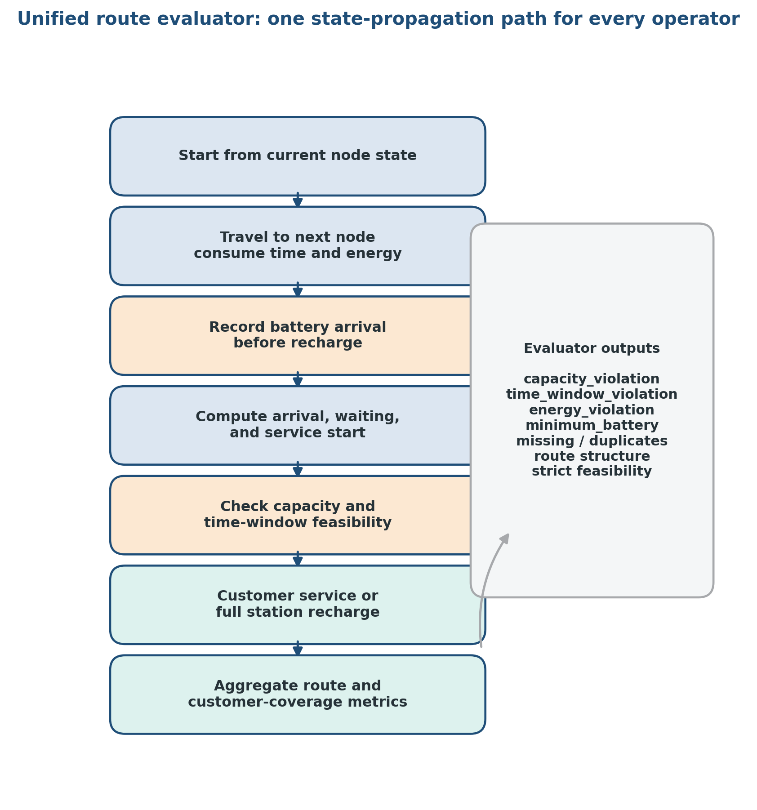
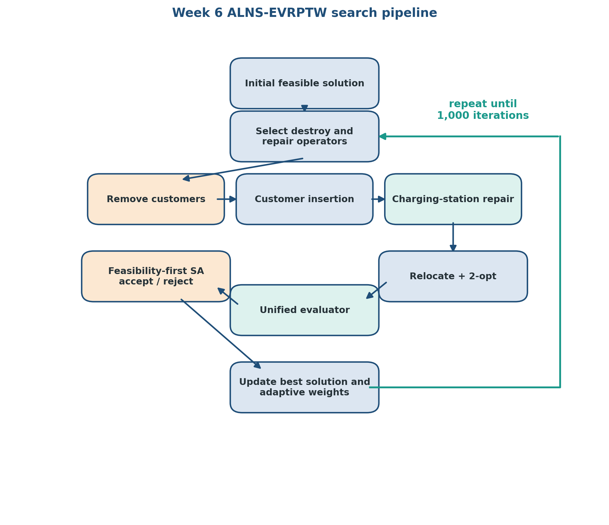
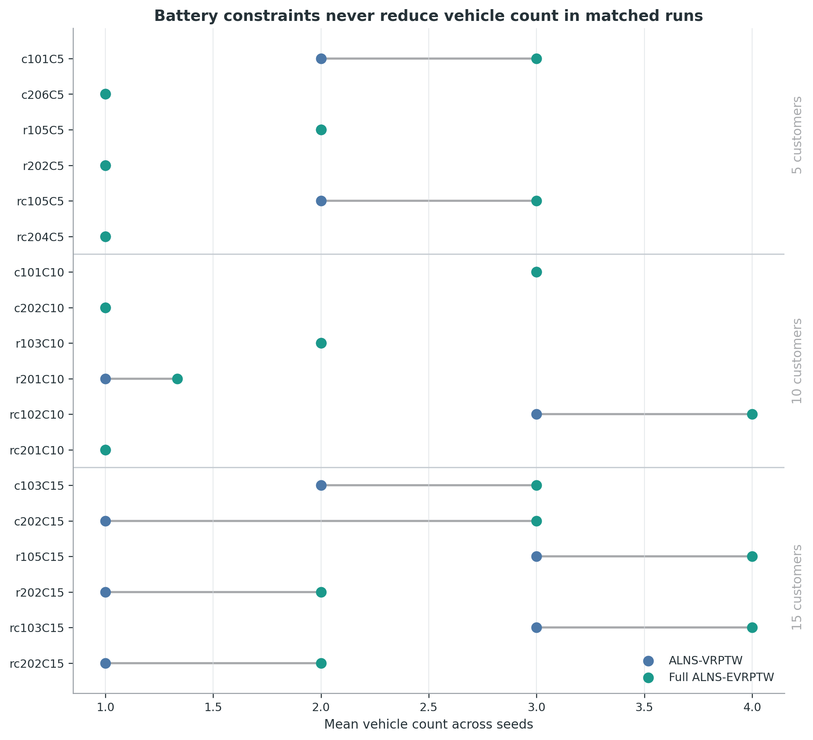
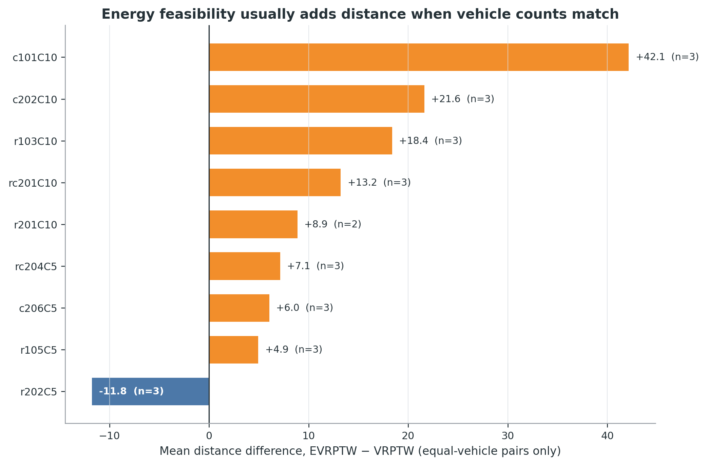
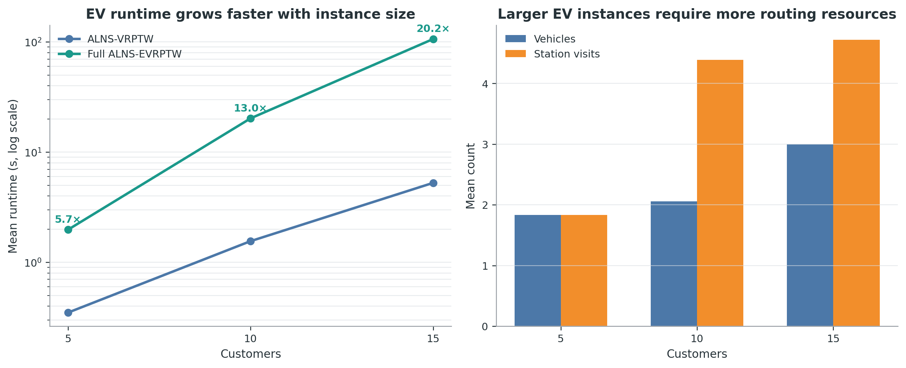
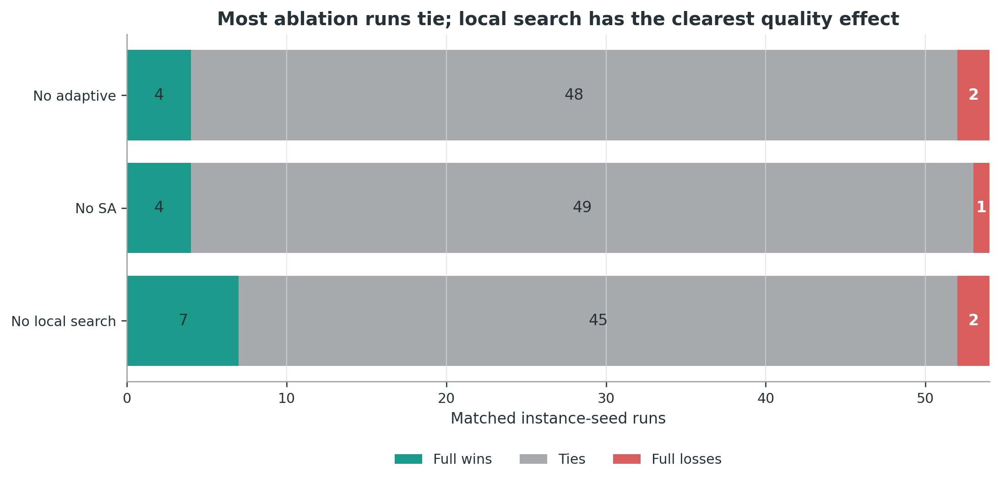
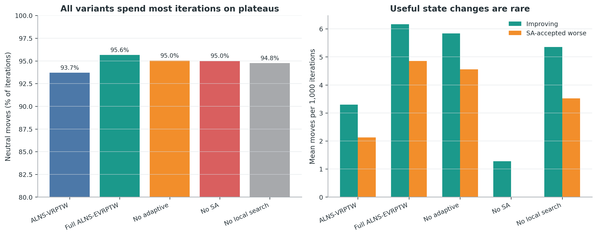

# Final Summer Project Report

## A Feasibility-First Full-Recharge ALNS for the Electric Vehicle Routing Problem with Time Windows

**Student:** Yuchi Dai<br>
**Supervisor:** Tianxiang Cui<br>
**Programme:** 2026 Summer Research Project, Faculty of Science and Engineering<br>
**Project area:** Electric vehicle routing and combinatorial optimisation<br>
**Date:** September 2026

## Abstract

This project studies the Electric Vehicle Routing Problem with Time Windows
(EVRPTW), in which electric vehicles must serve customers while satisfying
vehicle-capacity, customer time-window, and battery constraints. The summer
work began with deep-reinforcement-learning and genetic-algorithm baselines.
Early experiments showed that a low routing cost did not guarantee a feasible
solution: the penalty-based genetic algorithm frequently retained late
customers and did not model battery consumption or charging stations.

The final project therefore focused on a feasibility-first Adaptive Large
Neighborhood Search (ALNS) solver for the full-recharge EVRPTW. The solver uses
one evaluator for customer coverage, route structure, capacity, time windows,
and battery state. It combines deterministic feasible construction, adaptive
destroy-and-repair operators, charging-station insertion, local search, and
simulated-annealing acceptance. A controlled experiment evaluated the method
on 18 small Schneider benchmark instances with three random seeds. Across 270
formal runs, all 216 battery-enabled runs were strictly feasible when checked
again with the same unified evaluator. The results also show the additional
routing and computational cost introduced by battery constraints. The work is
a verified method-level adaptation and experimental study; it does not claim a
complete numerical reproduction of an original paper or state-of-the-art
performance.

## 1. Project Motivation

Vehicle Routing Problems assign customers to vehicle routes while minimising
an objective such as fleet size or travel distance. EVRPTW adds two practical
requirements: vehicles have limited battery capacity and customers must be
served within specified time windows. Routes may therefore require visits to
charging stations, and a short route can still be invalid if it arrives late
or exhausts the battery.

The project initially investigated the deep reinforcement learning approach of
Lin, Ghaddar, and Nathwani (2021). POMO and GA-VRPTW baselines were recreated to
understand learning-based routing and classical search. The original POMO
implementation did not contain time-window, battery, or charging-station logic,
while the GA baseline handled time windows through penalties and did not model
electric vehicles. These limitations motivated a narrower final question:

> Can a route-based ALNS with a unified feasibility evaluator consistently
> construct and improve strictly feasible full-recharge EVRPTW solutions?

This change of direction prioritised a complete and auditable EVRPTW pipeline
over an unfinished learning model.

## 2. Development During the Summer

The work progressed through four experimental stages.

1. **Baseline recreation.** POMO was tested on TSP and CVRP checkpoints, and a
   GA-VRPTW baseline was run on Solomon instances.
2. **Controlled GA evaluation.** Search-budget experiments showed that more
   computation improved penalised cost but did not establish strict
   feasibility.
3. **Feasibility diagnostics and repair.** Explicit lateness, capacity, and
   waiting-time metrics were added. Relocate and bounded 2-opt repair reduced
   violations, but none of the 27 Week 5 runs became strictly feasible.
4. **Full-recharge ALNS-EVRPTW.** A separate route-based implementation added
   hard feasibility checks, energy propagation, charging-station repair,
   adaptive operators, simulated annealing, and local search.

The final report concentrates on Stage 4. The earlier stages provide evidence
for why the final design uses strict feasibility rather than penalty-only
evaluation. Detailed weekly records remain available in [`docs/`](docs/).

## 3. Problem Definition

Each route begins and ends at a depot. Customer and charging-station visits
appear between the two depot visits, for example:

```text
[D0, C3, S1, C8, D0]
```

For every travelled edge, the evaluator propagates arrival time, waiting time,
vehicle load, and remaining battery. At a charging station, the vehicle is
restored to full battery capacity and the corresponding charging time is added.
The evaluator checks the battery before applying a recharge, so an infeasible
arrival at a station cannot be hidden.

A solution is strictly feasible only when:

- every customer is served exactly once;
- every route starts and ends at the depot;
- capacity violation is zero;
- time-window violation is zero;
- energy violation is zero.

The objective follows a lexicographic ordering: first minimise the number of
active vehicles, then minimise total distance among solutions using the same
number of vehicles.

## 4. Final Method

### 4.1 Unified feasibility evaluator

One evaluator is shared by construction, customer insertion, station repair,
local search, acceptance, and final auditing. It reports missing or duplicate
customers, structural violations, capacity violation, time-window violation,
energy violation, minimum battery, station visits, charging time, waiting time,
fleet size, and total distance.



### 4.2 Initial construction

Customers are ordered by due time and inserted one at a time. The constructor
tests positions in existing routes and the option of opening a new route. When
battery constraints are enabled, charging-station repair is attempted before a
candidate is accepted. Candidates must pass the complete feasibility evaluator.

### 4.3 ALNS operators

The destroy pool contains random, worst, and related removal. The repair pool
contains greedy and regret-2 insertion. Relocate and intra-route 2-opt provide
local improvement. Segment-based adaptive weights change how often the destroy
and repair operators are selected according to their recent outcomes.

### 4.4 Charging-station repair

When the first energy-infeasible arc is found, the repair procedure tests
charging stations on that arc and, if necessary, on progressively earlier
arcs. Each candidate route is evaluated again to detect charging-induced time
window violations. The feasible insertion with the smallest additional
distance is selected.

### 4.5 Acceptance

Infeasible candidates and candidates using more vehicles are rejected. A
candidate with fewer vehicles is accepted as an improvement. For equal fleet
size, shorter routes improve the objective, neutral routes support plateau
exploration, and longer routes may be accepted by simulated annealing.



## 5. Experimental Design

The formal experiment used 18 Schneider instances covering clustered,
random, and mixed customer layouts with 5, 10, and 15 customers. Each method
was run with seeds 64, 65, and 66 for 1,000 iterations.

Five configurations were compared:

- ALNS-VRPTW without battery constraints;
- full ALNS-EVRPTW;
- ALNS-EVRPTW without adaptive weights;
- ALNS-EVRPTW without simulated annealing;
- ALNS-EVRPTW without local search.

This produced 270 formal runs. The VRPTW comparison isolates the effect of
battery and charging constraints on the same customer data. The three
ablations test the contribution of adaptive weights, simulated annealing, and
local search.

## 6. Results

### 6.1 Correctness and feasibility

All saved formal routes were loaded and evaluated again. All 216
battery-enabled runs were strictly feasible, and the recomputed metrics agreed
with the saved results. This audit supports the main implementation claim:
the final pipeline constructs and preserves feasible full-recharge EVRPTW
solutions on the tested instances.

### 6.2 Effect of battery constraints

Across the 54 matched VRPTW and EVRPTW runs, EVRPTW used more vehicles in 28
comparisons and never used fewer. Among the 26 comparisons with equal fleet
size, the EVRPTW route was longer in 23 cases. The mean EVRPTW-minus-VRPTW
distance difference for these equal-fleet comparisons was +12.419.





### 6.3 Runtime and charging

The mean EVRPTW-to-VRPTW runtime ratio increased with customer count: 5.65 at
5 customers, 13.02 at 10 customers, and 20.22 at 15 customers. Charging repair
and repeated route evaluation therefore form a substantial part of the cost.



### 6.4 Ablation study

Local search had the clearest quality effect. The full method won 7, tied 45,
and lost 2 matched comparisons against the no-local-search configuration.
Removing local search reduced runtime by 47.3%, showing a clear quality-runtime
trade-off. Adaptive weights and simulated annealing had smaller positive
effects on the tested small instances.



### 6.5 Search behaviour

The full EVRPTW method spent 95.6% of its iterations on equal-objective
candidates. The small instances and deterministic initial constructor often
produced the same final objective across seeds. This indicates that search
diversity, rather than basic feasibility, is the main limitation of the current
solver.



## 7. Discussion

The final implementation demonstrates that a shared evaluator and explicit
charging repair can maintain capacity, time-window, and battery feasibility
throughout a route-based ALNS pipeline. The experiment also quantifies two
effects of electrification: additional vehicles or detours may be needed, and
the feasibility checks and station-repair process increase runtime.

The project does not establish that the solver is state of the art. The
benchmark contains only 5 to 15 customers, only three random seeds were used,
and the deterministic constructor dominates many easy instances. Station
repair is greedy, only full recharge is supported, and the method has no
station-removal neighborhood. The GA results from earlier weeks use different
data and objectives and are therefore historical motivation rather than a
direct numerical baseline.

The supported conclusion is deliberately narrow:

> The project produced a verified full-recharge ALNS-EVRPTW vertical slice
> that maintains strict feasibility and exposes the routing and computational
> effects of battery constraints on the tested small instances.

## 8. Conclusion

The summer project progressed from baseline recreation and penalty-based
VRPTW experiments to a strictly feasible full-recharge EVRPTW solver. The
final ALNS combines a unified evaluator, charging-station repair, adaptive
destroy-and-repair selection, local search, and simulated annealing. Its 270-run
evaluation provides reproducible evidence for correctness, feasibility, the
cost of battery constraints, and the role of individual search components.

The project is now frozen at this verified Week 6 baseline. Partial charging,
larger instances, and new search operators remain possible research extensions
but are outside the completed summer-project scope.

## 9. Reproducibility and Evidence

Run the Week 6 tests from the repository root:

```bash
python -m pytest -q labs/week6/tests
```

Run a configuration check after downloading the Schneider instances:

```bash
python -m labs.week6.src.run_week6_alns --check-config
```

The Schneider EVRPTW benchmark instances are available from the authors'
[Mendeley Data record](https://data.mendeley.com/datasets/h3mrm5dhxw/1). Place
the extracted instance files under `data/schneider_instances/`. The benchmark
files are treated as external research data and are not duplicated in this
repository.

The principal evidence is stored in:

- [`labs/week6/`](labs/week6/) for the implementation and tests;
- [`results/week6/main_fixed1000/`](results/week6/main_fixed1000/) for the
  formal ALNS-VRPTW and ALNS-EVRPTW summaries;
- [`results/week6/`](results/week6/) for component ablations;
- [`outputs/week6_analysis_20260725/`](outputs/week6_analysis_20260725/) for
  analysis tables and the workbook;
- [`docs/figures/week06/`](docs/figures/week06/) for report figures;
- [`docs/week06_alns_evrptw_report.md`](docs/week06_alns_evrptw_report.md) for
  the full technical record of the Week 6 implementation and experiment.

## References

1. Lin, B., Ghaddar, B., and Nathwani, J. (2021). Deep Reinforcement
   Learning for Electric Vehicle Routing Problem with Time Windows. *IEEE
   Transactions on Intelligent Transportation Systems*.
2. Schneider, M., Stenger, A., and Goeke, D. (2014). The Electric
   Vehicle-Routing Problem with Time Windows and Recharging Stations.
   *Transportation Science*, 48(4), 500-520.
3. Keskin, M., and Catay, B. (2016). Partial Recharge Strategies for the
   Electric Vehicle Routing Problem with Time Windows. *Transportation
   Research Part C*, 65, 111-127.
4. Pisinger, D., and Ropke, S. (2007). A General Heuristic for Vehicle
   Routing Problems. *Computers & Operations Research*, 34(8), 2403-2435.
