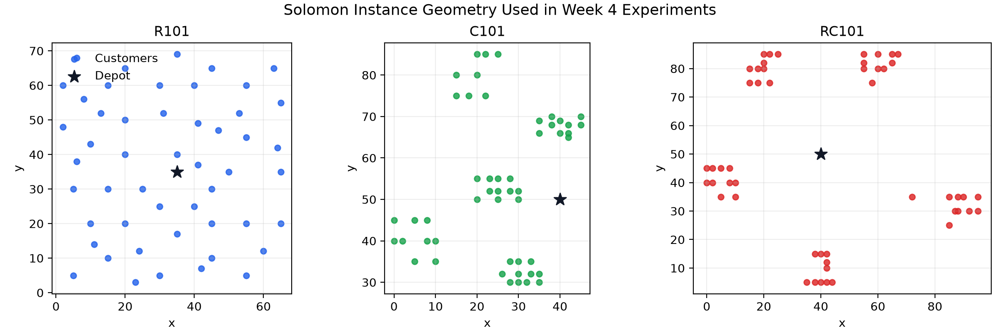
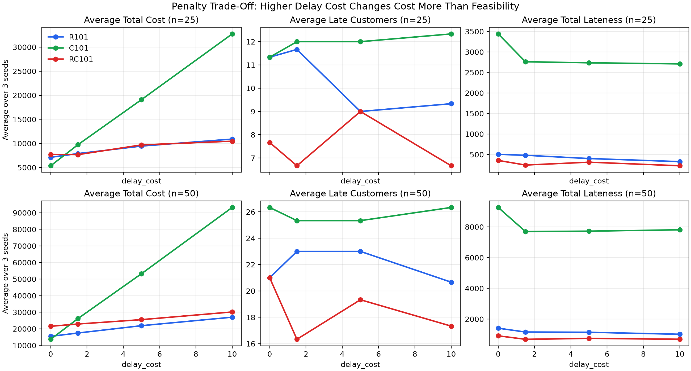
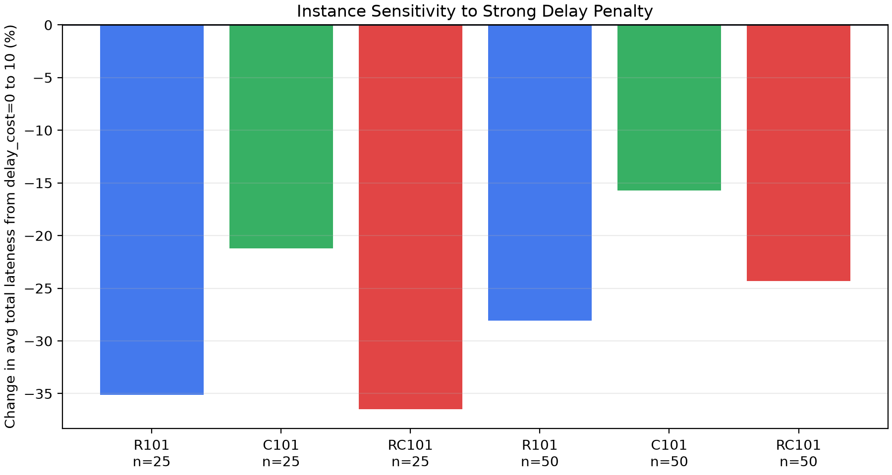

# Week 4 Report: Feasibility-Aware Evaluation of a Penalty-Based GA-VRPTW Baseline

This report addresses the Week 4 task in [`labs/tasks/week04_works.md`](../labs/tasks/week04_works.md). The goal this week was not to claim a complete EVRP-TW solver, but to make a controlled step from a runnable GA-VRPTW baseline toward feasibility-aware EVRP-TW experimentation.

## 1. Goal This Week

The main experiment question is:

Can increasing the delay penalty in a GA-VRPTW baseline reduce time-window violations, or does it mainly increase the penalized objective without guaranteeing strict feasibility?

This question matters because the original GA only reports an aggregate `Total cost`. For EVRP-TW research, objective value alone is not enough. A route can look cheap while still being infeasible due to time-window or battery violations.

## 2. Literature Motivation

Two Week 4 readings motivated this direction:

- Schneider, Stenger, and Goeke (2014) define the canonical EVRP-TW with time windows, battery constraints, and recharging stations. Their formulation makes feasibility central, not secondary.
- Keskin and Catay (2016) extend EVRP-TW with partial recharge and show that charging decisions interact strongly with time-window feasibility.

Both papers suggest that a useful routing experiment should report violations explicitly. Before adding EV-specific battery and station logic, the VRPTW layer should first expose whether its time-window penalty actually controls lateness.

Related notes:

- [`docs/week04_schneider2014_note.md`](week04_schneider2014_note.md)
- [`docs/week04_keskin2016_note.md`](week04_keskin2016_note.md)

## 3. Original GA Baseline

The tested baseline is the cloned GA-VRPTW implementation in [`labs/week4/py-ga-VRPTW`](../labs/week4/py-ga-VRPTW).

Its main design is:

- chromosome: a permutation of customers `1..ind_size`;
- decoding: split the customer sequence into vehicle routes using capacity and depot due-time checks;
- objective: vehicle start cost + travel distance cost + waiting cost + delay penalty;
- selection: roulette-wheel selection;
- crossover: partially matched crossover;
- mutation: inverse segment mutation.

The baseline is still a VRPTW solver. It does not model electric vehicle battery, charging stations, full recharge, or partial recharge.

## 4. Week 4 Modification

I kept the GA search logic unchanged and added explicit route-evaluation metrics:

- `late_customer_count`;
- `total_lateness`;
- `max_lateness`;
- `waiting_time`;
- `delay_penalty`;
- `route_count`;
- `total_distance`;
- `strict_time_window_feasible`.

This separates solution quality from feasibility diagnostics. The implementation is in [`labs/week4/py-ga-VRPTW/gavrptw/core.py`](../labs/week4/py-ga-VRPTW/gavrptw/core.py), with the new batch runner in [`labs/week4/py-ga-VRPTW/run_week4_experiments.py`](../labs/week4/py-ga-VRPTW/run_week4_experiments.py).

## 5. Experiment Design

The controlled variable is `delay_cost`.

| Factor | Values |
|---|---|
| Instances | `R101`, `C101`, `RC101` |
| Customer scales | `25`, `50` |
| Random seeds | `11`, `22`, `33` |
| Delay cost | `0.0`, `1.5`, `5.0`, `10.0` |
| Population size | `80` |
| Generations | `100` |
| Crossover probability | `0.85` |
| Mutation probability | `0.01` |

Total runs:

```text
3 instances × 2 scales × 4 delay-cost levels × 3 seeds = 72 runs
```

The full run-level result table is stored in [`labs/week4/ga_delay_sensitivity_results.csv`](../labs/week4/ga_delay_sensitivity_results.csv). The aggregated table is stored in [`labs/week4/ga_delay_sensitivity_summary.csv`](../labs/week4/ga_delay_sensitivity_summary.csv).

## 6. Visual Results

### Instance Geometry



The three tested Solomon instances have visibly different spatial structures. `R101` is randomly distributed, `C101` is clustered, and `RC101` mixes clustered and random patterns. This helps explain why the same penalty setting may behave differently across instance families.

### Penalty Trade-Off



The clearest pattern is that increasing `delay_cost` raises the reported total cost, especially on `C101`. However, lateness does not disappear. In several settings, the number of late customers remains nearly flat even as the penalty becomes much larger.

This means the GA reacts to the penalty in the objective, but penalty tuning alone does not guarantee strict time-window feasibility.

### Instance Sensitivity



Moving from no delay penalty (`delay_cost=0`) to strong delay penalty (`delay_cost=10`) reduces average total lateness in all tested instance-scale combinations. The reduction is strongest for `R101-25` and `RC101-25`, and weaker for `C101-50`.

This suggests that instance structure matters. Clustered instances with tight route interactions may be harder to fix through penalty scaling alone.

## 7. Main Findings

1. Stronger delay penalties increase the objective value substantially.

The most obvious effect of larger `delay_cost` is a higher penalized `Total cost`. For example, `C101-50` increased from about `13,692` at `delay_cost=0` to about `93,209` at `delay_cost=10`.

2. Lateness is reduced, but not eliminated.

Total lateness generally decreases when a delay penalty is introduced. For example, `R101-25` average total lateness decreased from about `504.32` to `327.20` when moving from `delay_cost=0` to `delay_cost=10`.

3. Strict feasibility was not achieved.

Across all 72 runs, none were strictly time-window feasible under the added checker. This is the most important diagnostic result. It shows that the original GA can optimize a penalized objective, but it should not be interpreted as a strict feasible VRPTW or EVRP-TW solver.

4. Penalty tuning is weaker than repair.

The results support the idea from Schneider and Keskin that feasibility-aware routing usually needs explicit repair, local search, or station insertion mechanisms. A penalty coefficient can guide the search, but it does not by itself enforce constraints.

## 8. Limitations

- This is still a VRPTW experiment, not a complete EVRP-TW experiment.
- Battery capacity, charging stations, full recharge, and partial recharge are not yet implemented in this GA.
- The current GA uses a simple permutation representation and penalty objective, so it may not have enough local improvement power to remove all lateness.
- Only three Solomon instances and three seeds were used per setting. This is sufficient for a Week 4 diagnostic study, but not for final benchmark claims.

## 9. Next Steps

The next extension should be staged:

```text
GA-VRPTW
-> violation-aware GA-VRPTW
-> battery-aware route evaluation
-> charging-station insertion / repair
-> full-recharge GA-EVRPTW
-> partial-recharge extension
```

For Week 5, the most practical next step is to add a simple battery-aware evaluator or route-level energy proxy, then test whether routes that look good under VRPTW remain feasible under EV-style range limits.

## 10. Reproducibility

The main experiment can be rerun from the repository root:

```bash
make week4-experiments
make week4-figures
make week4-test
```

Generated artifacts:

- run-level results: [`labs/week4/ga_delay_sensitivity_results.csv`](../labs/week4/ga_delay_sensitivity_results.csv);
- aggregated results: [`labs/week4/ga_delay_sensitivity_summary.csv`](../labs/week4/ga_delay_sensitivity_summary.csv);
- figures: [`docs/figures/week04`](figures/week04);
- experiment logs: [`labs/week4/py-ga-VRPTW/experiment_logs`](../labs/week4/py-ga-VRPTW/experiment_logs).

