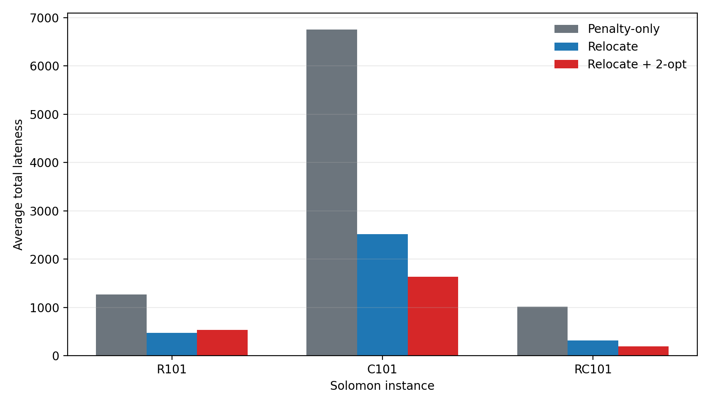
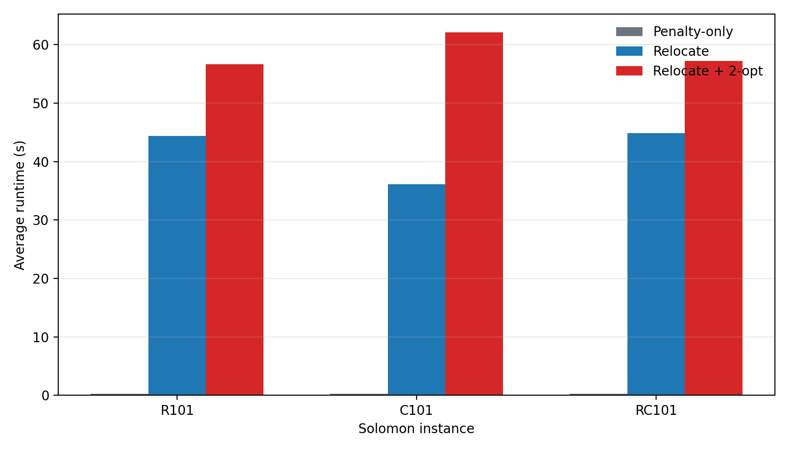

# Week 5 Report: Repair-Aware GA-VRPTW with Relocate and 2-opt Local Search

This report addresses the Week 5 consolidation task in [`labs/tasks/week05_works.md`](../labs/tasks/week05_works.md). It follows the Week 4 finding that delay penalties reduce lateness but do not guarantee strict time-window feasibility. The Week 5 extension therefore tests explicit route repair rather than further penalty tuning.

## 1. Current Status and Goal

The project is still evaluating a GA-VRPTW baseline, not a complete EVRP-TW solver. Battery capacity, charging stations, full recharge, and partial recharge are not yet included.

The Week 5 question is:

> Can targeted relocate repair, with optional 2-opt refinement, reduce time-window violations more effectively than the penalty-only GA-VRPTW baseline?

This is both a Track B consolidation and a focused Track C extension. It makes the Week 4 feasibility diagnosis reproducible, then adds two bounded local-search operators while keeping the GA representation and global parameters fixed.

## 2. Week 5 Modification

### Feasibility-Aware Schedule Evaluation

The route evaluator now propagates time correctly through travel, waiting, service, and depot return:

```text
arrival time = previous service completion time + travel time
service start = max(arrival time, customer ready time)
```

It reports customer lateness, total lateness, maximum lateness, depot-return lateness, capacity violation, distance, route count, and strict feasibility. Waiting is included before the next route leg, so an early arrival can delay later customers as it should in VRPTW.

### Repair Pipeline

The repair pipeline is evaluated after chromosome decoding:

```text
GA chromosome
-> decode vehicle routes
-> evaluate capacity and time-window violations
-> up to 5 relocate moves
-> up to 3 intra-route 2-opt moves
-> evaluate repaired route for fitness
```

Relocate targets the most late customers and tests insertion positions across decoded routes. 2-opt reverses a contiguous segment within one route. Both operators accept only a strict improvement under this lexicographic score:

```text
capacity violation
-> late-customer count
-> total lateness
-> maximum lateness
-> total distance
```

Candidate and accepted-route signatures are tracked to avoid duplicate work and cycles. The repair is Baldwinian: it changes the route used to compute fitness but does not overwrite the original GA chromosome.

## 3. Experiment Design

| Factor | Setting |
|---|---|
| Methods | `penalty_only`, `relocate_repair`, `relocate_2opt_repair` |
| Solomon instances | `R101`, `C101`, `RC101` |
| Customer scale | 25 |
| Random seeds | `64`, `65`, `66` |
| Population size | 80 |
| Generations | 100 |
| Crossover / mutation | 0.85 / 0.01 |
| Delay cost | 1.5 |
| Relocate budget | 5 moves |
| 2-opt budget | 3 moves |

The same seed is reset before each method, so every comparison starts from the same GA randomness. In total, the experiment contains 27 runs:

```text
3 instances x 3 methods x 3 seeds = 27 runs
```

## 4. Results

The following table averages the three seeds for each instance-method pair. `Feasible` is the number of strictly time-window-feasible runs.

| Instance | Method | Avg cost | Avg late customers | Avg total lateness | Feasible | Avg runtime |
|---|---|---:|---:|---:|---:|---:|
| R101 | Penalty-only | 9334.10 | 13.67 | 1272.27 | 0/3 | 0.26 s |
| R101 | Relocate | 7435.43 | 9.00 | 478.57 | 0/3 | 44.41 s |
| R101 | Relocate + 2-opt | 7054.63 | 9.67 | 540.26 | 0/3 | 56.64 s |
| C101 | Penalty-only | 15200.96 | 16.33 | 6756.82 | 0/3 | 0.25 s |
| C101 | Relocate | 7481.55 | 11.33 | 2519.32 | 0/3 | 36.11 s |
| C101 | Relocate + 2-opt | 6241.25 | 7.00 | 1637.73 | 0/3 | 62.13 s |
| RC101 | Penalty-only | 9498.49 | 12.67 | 1017.45 | 0/3 | 0.27 s |
| RC101 | Relocate | 6778.92 | 6.33 | 316.99 | 0/3 | 44.85 s |
| RC101 | Relocate + 2-opt | 6616.14 | 5.33 | 192.26 | 0/3 | 57.23 s |

### Time-Window Violation Reduction



Relocate repair reduces average total lateness on all three instance families. Adding 2-opt gives further reductions on `C101` and `RC101`. The R101 result is different: 2-opt lowers average cost but slightly increases average lateness relative to relocate-only.

### Runtime Trade-Off



Explicit repair is much slower than the penalty-only baseline. Relocate costs about 36--45 seconds per run, while relocate plus 2-opt costs about 57--62 seconds. The additional local search therefore buys substantially lower violations at a clear computational cost.

## 5. Main Findings

1. **Repair is more effective than penalty-only search for reducing violations.** Relocate lowers both average late-customer count and total lateness on every tested instance.

2. **2-opt has instance-dependent value.** It provides the strongest additional benefit on clustered `C101` and mixed `RC101`, where route-order refinement can reduce lateness further. On random `R101`, it finds lower-cost routes but does not improve lateness beyond relocate-only.

3. **The R101 trade-off is expected under the current global fitness.** Repair itself accepts only strict lexicographic improvements. However, adding 2-opt changes individual fitness values and therefore changes GA selection and later evolutionary trajectories. The global objective still uses a finite delay cost of 1.5, so a lower-distance route can be preferred even when it has somewhat more lateness.

4. **Strict feasibility was not achieved.** None of the 27 runs is strictly feasible. Week 5 therefore demonstrates substantial violation reduction, not a complete solution to VRPTW feasibility.

## 6. Limitations

- The solver remains a VRPTW baseline, not an EVRP-TW solver.
- The repair search is bounded and local; it cannot insert new routes or globally rebuild a solution.
- The global GA fitness is still a weighted penalty objective, which can trade lateness against distance.
- Only three 25-customer Solomon instances and three seeds were tested.
- Repair increases runtime by roughly two orders of magnitude relative to the penalty-only baseline.

## 7. Next Step

Before adding battery and charging constraints, the next focused step should be to make the global GA selection feasibility-first. One option is a large infeasibility penalty per late customer, combined with total-lateness penalty. The same fitness change should then be tested fairly with penalty-only, relocate, and relocate-plus-2-opt variants.

Once strict VRPTW feasibility is more reliable, the staged EVRP-TW path remains:

```text
feasibility-first GA-VRPTW
-> battery-aware route evaluation
-> charging-station insertion / repair
-> full-recharge GA-EVRPTW
-> partial-recharge extension
```

## 8. Reproducibility and Evidence

The Week 5 workspace is [`labs/week5/py-ga-VRPTW`](../labs/week5/py-ga-VRPTW). From that directory:

```bash
make test
make compare-all
make week5-figures
```

Artifacts:

- run-level comparison data: [`labs/week5/py-ga-VRPTW/results/week05_repair_comparison.csv`](../labs/week5/py-ga-VRPTW/results/week05_repair_comparison.csv);
- per-run logs: [`labs/week5/py-ga-VRPTW/results/week05_logs`](../labs/week5/py-ga-VRPTW/results/week05_logs);
- repair implementation: [`labs/week5/py-ga-VRPTW/gavrptw/core.py`](../labs/week5/py-ga-VRPTW/gavrptw/core.py);
- figures: [`docs/figures/week05`](figures/week05).
