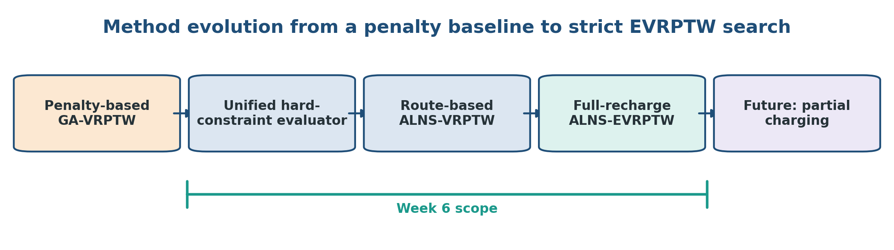

# Week 6 Report: A Full-Recharge ALNS Vertical Slice for EVRPTW

This report documents the Week 6 transition from a penalty-based GA-VRPTW
baseline to a route-based Adaptive Large Neighborhood Search (ALNS) solver
with a unified hard-constraint evaluator for the Electric Vehicle Routing
Problem with Time Windows (EVRPTW).

The implementation is a method-level adaptation of the ALNS structure in
Keskin and Çatay (2016), combined with the full-recharge EVRPTW assumptions
used by Schneider, Stenger, and Goeke (2014). Partial charging is deliberately
excluded from Week 6.

## 1. Research Question and Scope

The Week 5 GA experiments showed that explicit relocate and 2-opt repair can
reduce lateness, but none of the 27 runs became strictly time-window feasible.
The Week 6 question is therefore:

> Can a route-based ALNS, supported by one unified capacity, time-window, and
> battery evaluator, consistently construct and improve strictly feasible
> full-recharge EVRPTW solutions?

Week 6 implements:

- a raw-unit Schneider instance loader;
- one evaluator for customer coverage, route structure, capacity, time
  windows, and battery;
- deterministic feasible initial construction;
- random, worst, and related removal;
- greedy and regret-2 insertion;
- greedy full-recharge station insertion;
- relocate and intra-route 2-opt local search;
- feasibility-first simulated annealing acceptance;
- segment-based adaptive destroy and repair weights;
- fixed-iteration reproducible experiments and component ablations.

It does not implement:

- partial charging;
- nonlinear charging;
- heterogeneous vehicles;
- station-removal neighborhoods;
- optimality guarantees;
- a complete numerical reproduction of Keskin and Çatay (2016).



The Week 5 GA remains a historical baseline. It uses different Solomon data,
a different cost function, and solutions that are not strictly time-window
feasible. Its aggregate cost must not be numerically ranked against the Week 6
ALNS distance.

## 2. EVRPTW Representation and Objective

Each route explicitly begins and ends at the depot. Customer and charging
station visits appear inside the route:

```text
[D0, C3, S1, C8, D0]
```

A solution is a list of vehicle routes:

```text
[
    [D0, C3, S1, C8, D0],
    [D0, C2, C5, D0],
]
```

The main benchmark parameters are loaded from each Schneider instance.

| Symbol | Meaning |
|---|---|
| $Q$ | battery capacity |
| $C$ | vehicle load capacity |
| $r$ | energy consumption per unit distance |
| $g$ | charging time per unit energy |
| $v$ | vehicle speed |
| $b_i$ | remaining battery at node $i$ |
| $t_i$ | propagated arrival or service time at node $i$ |

The solver uses the lexicographic Schneider-style objective:

```text
1. minimize number of active vehicles
2. minimize total distance among equal-vehicle solutions
```

This ordering is important throughout the analysis. A shorter route using more
vehicles is not considered better. Distances from two methods are interpreted
directly only when their vehicle counts are equal.

## 3. Unified Feasibility Evaluator

For every edge $i \rightarrow j$, the evaluator propagates:

$$
d_{ij} = \sqrt{(x_i-x_j)^2 + (y_i-y_j)^2}
$$

$$
t^{arrival}_j = t^{departure}_i + \frac{d_{ij}}{v}
$$

$$
b^{arrival}_j = b^{departure}_i - r d_{ij}
$$

The battery is checked before any recharge is applied. Negative arrival
battery therefore remains observable instead of being clamped away.

Service begins at:

$$
t^{service}_j =
\max\left(t^{arrival}_j,\; ready_j\right)
$$

At a customer, demand and service time are added. At a charging station, the
vehicle is restored to full capacity:

$$
\Delta b_j = Q - b^{arrival}_j
$$

$$
t^{charge}_j = g \Delta b_j
$$

The same evaluator is called by construction, charging repair, customer
insertion, local search, acceptance, and final result auditing.


The solution is strictly feasible only when:

- every customer is served exactly once;
- every route starts and ends at the depot;
- capacity violation is zero;
- time-window violation is zero;
- energy violation is zero when battery constraints are enabled.

The evaluator reports:

```text
missing_customer_count
duplicate_customer_count
route_structure_violation
capacity_violation
time_window_violation
energy_violation
minimum_battery
late_customer_count
station_visits
charging_time
waiting_time
```

## 4. ALNS-EVRPTW Method

### 4.1 Initial Construction

Customers are ordered by due time and inserted one at a time. For every
customer, construction tests:

1. every position in each existing route;
2. opening a new vehicle route;
3. charging-station repair when battery constraints are enabled;
4. full capacity, time-window, energy, and coverage feasibility.

The feasible candidate with the fewest vehicles and then shortest distance is
selected. This produces a deterministic feasible starting solution.

### 4.2 Destroy and Customer Repair

The destroy pool contains:

- `random_removal`;
- `worst_removal`;
- `related_removal`.

The repair pool contains:

- `greedy_insertion`;
- `regret_2_insertion`.

Station visits are removed before customer-order reconstruction and calculated
again afterwards. This prevents obsolete charging stops from being preserved.

### 4.3 Charging-Station Repair

When a route first reaches a node with negative battery, repair:

1. identifies the failing arc;
2. tests every charging station on that arc;
3. if required, tests progressively earlier arcs;
4. rejects stations that remain energy-infeasible;
5. re-evaluates the complete route to detect charging-induced lateness;
6. chooses the feasible insertion with the smallest additional distance.

The process repeats until the route is feasible or the configured station
insertion budget is exhausted.

### 4.4 Local Search, Acceptance, and Adaptive Weights

Relocate and intra-route 2-opt are applied with probability 0.20. Candidate
acceptance is feasibility-first:

```text
infeasible candidate              -> reject
fewer vehicles                    -> accept as improving
more vehicles                     -> reject
same vehicles and shorter route   -> accept as improving
same objective                    -> accept as neutral
same vehicles and longer route    -> simulated annealing
```

Neutral moves remain accepted for plateau exploration but receive zero
adaptive reward. Improving, neutral, SA-accepted-worse, and rejected outcomes
are recorded separately.

#### Role of Adaptive Weights

Adaptive weights do not change the objective function, feasibility rules, or
the operators themselves. Their role is to change how frequently each destroy
and repair operator is selected. If operator $i$ has weight $w_i$, its
roulette-wheel selection probability is:

$$
p_i = \frac{w_i}{\sum_k w_k}
$$

All operators start with weight 1.0, so selection is initially uniform. After
each iteration, the selected destroy and repair operators receive the same
reward according to the search outcome:

| Outcome | Reward |
|---|---:|
| new global best | 5 |
| improving accepted solution | 3 |
| SA-accepted worse solution | 1 |
| neutral solution | 0 |
| rejected solution | 0 |

Destroy and repair weights are updated every 50 iterations:

$$
w_{new}
= (1-\rho)w_{old}
+ \rho\frac{\text{segment reward}}{\text{segment uses}}
$$

Here, the reaction factor is $\rho=0.20$. Consequently, operators that have
recently produced useful moves become more likely to be selected, while the
old weight still contributes 80% of the new value. A minimum positive weight
keeps every operator available, preserving exploration.

The intended benefit is an automatic balance between exploitation and
exploration: the search can favor operators that work well for the current
instance without permanently removing the alternatives. It also avoids
manually fixing one operator mix for clustered, random, and mixed instances.
Adaptive weights are therefore an operator-selection policy, not an additional
repair method or feasibility constraint.


## 5. Experimental Design

### 5.1 Benchmark Selection

The experiment uses 18 Schneider instances covering:

- clustered `C` instances;
- random `R` instances;
- mixed `RC` instances;
- 5, 10, and 15 customers;
- two representative instances per family-size combination.

Every method is run with seeds `64`, `65`, and `66`.

### 5.2 Methods

| Method | Battery | Adaptive weights | SA | Local search |
|---|---:|---:|---:|---:|
| ALNS-VRPTW | off | on | on | on |
| Full ALNS-EVRPTW | on | on | on | on |
| No adaptive | on | off | on | on |
| No SA | on | on | off | on |
| No local search | on | on | on | off |

The primary comparison is:

```text
ALNS-VRPTW
vs.
Full ALNS-EVRPTW
```

The three EVRPTW ablations test the contributions of adaptive weights,
simulated annealing, and local search.

### 5.3 Search Budget

All formal runs use:

```text
18 instances
x 3 seeds
= 54 runs per method

5 methods
x 54 runs
= 270 formal runs
```

Every run receives exactly 1,000 ALNS iterations. No formal run uses a
wall-clock stopping limit. This replaces the earlier pilot protocol in which
some EVRPTW instances were truncated after 60 seconds.

## 6. Correctness and Feasibility Audit

The saved route of every formal run was parsed and passed back through the
unified evaluator. Recomputed values were compared with all stored CSV
metrics.

| Audit item | Result |
|---|---:|
| formal rows | 270 |
| unique instance-seed-method rows | 270 |
| runs completing 1,000 iterations | 270/270 |
| time-limit terminations | 0 |
| customer coverage errors | 0 |
| route-structure errors | 0 |
| stored/recomputed metric mismatches | 0 |
| EVRPTW capacity violations | 0/216 |
| EVRPTW time-window violations | 0/216 |
| EVRPTW energy violations | 0/216 |
| strictly feasible EVRPTW runs | 216/216 |

The 216 battery-enabled runs can be separated as follows:

| EVRPTW configuration | Strictly feasible runs | Instance groups with 3/3 feasible seeds |
|---|---:|---:|
| Full ALNS-EVRPTW | 54/54 | 18/18 |
| No adaptive weights | 54/54 | 18/18 |
| No simulated annealing | 54/54 | 18/18 |
| No local search | 54/54 | 18/18 |

Strict feasibility here means zero missing and duplicate customers, valid
depot route structure, zero capacity violation, zero time-window violation,
zero energy violation, and nonnegative minimum battery. The lowest recorded
minimum battery is `0.230403` for the full method and `0.046069` across all
four EVRPTW configurations, so feasibility is not caused by rounding a
negative battery value to zero.

ALNS-VRPTW is feasible with respect to customer coverage, route structure,
capacity, and time windows. Its negative battery values are expected because
energy constraints and charging repair are deliberately disabled in that
ablation.

This audit supports the first Week 6 conclusion: the vertical slice is not
merely producing short routes; it is consistently producing solutions that
are feasible under every enabled hard constraint. This is useful evidence
that the unified evaluator, route reconstruction, and charging-station repair
work together correctly.

However, a 100% feasibility rate is not by itself evidence of competitive
solution quality. The benchmark subset contains only 5--15 customers, and the
solver may preserve feasibility by using additional vehicles. Comparison
against published best-known vehicle counts and distances on larger Schneider
instances is still required before making a performance claim.

## 7. Main Comparison: VRPTW versus EVRPTW

### 7.1 Vehicle Count

Across 54 matched instance-seed runs:

| Vehicle relationship | Matched runs |
|---|---:|
| EVRPTW uses more vehicles | 28 |
| same vehicle count | 26 |
| EVRPTW uses fewer vehicles | 0 |

The mean vehicle count rises from `1.722` in ALNS-VRPTW to `2.296` in full
ALNS-EVRPTW.


The effect becomes more pronounced at 15 customers. The VRPTW mode averages
`1.833` vehicles at that size, while the full EVRPTW mode averages `3.000`.
The additional vehicles are a direct response to limited range, charging
detours, and the interaction between charging time and customer time windows.

### 7.2 Distance among Equal-Vehicle Pairs

Distance is compared only for the 26 matched runs with the same vehicle count:

| Distance relationship | Matched runs |
|---|---:|
| EVRPTW distance is longer | 23 |
| equal within tolerance | 0 |
| EVRPTW distance is shorter | 3 |

The mean EVRPTW-minus-VRPTW distance difference is `+12.419`.


The three negative differences all belong to `r202C5`. This does not imply
that adding energy constraints improves the theoretical optimum. The two
heuristics follow different search trajectories, and the EVRPTW search found
a shorter customer order that the VRPTW run missed.

The unconditioned mean distances are `318.284` for ALNS-VRPTW and `303.173`
for full ALNS-EVRPTW. These values must not be used to claim that EVRPTW is
shorter, because the EVRPTW method frequently uses more vehicles.

## 8. Scalability and Charging Cost

| Customers | VR vehicles | EV vehicles | VR runtime | EV runtime | EV/VR runtime | EV station visits |
|---:|---:|---:|---:|---:|---:|---:|
| 5 | 1.500 | 1.833 | 0.350 s | 1.977 s | 5.65× | 1.833 |
| 10 | 1.833 | 2.056 | 1.557 s | 20.273 s | 13.02× | 4.389 |
| 15 | 1.833 | 3.000 | 5.265 s | 106.437 s | 20.22× | 4.722 |


Runtime grows much faster in EVRPTW mode. Charging repair tests station
insertions and fully re-evaluates each repaired route because charging time
can invalidate later customer time windows. This repeated evaluation is
correct but computationally expensive.

The number of charging-station visits increases sharply between 5 and 10
customers, then grows more slowly from 10 to 15. Vehicle count continues to
increase at 15 customers, suggesting that additional routes sometimes become
more effective than further charging detours.

## 9. Ablation Study

Each ablation is paired with the full EVRPTW method using the same instance and
seed. The comparison uses the lexicographic vehicle-distance objective.

| Ablation | Full wins | Ties | Full losses | Ablation runtime change | Mean distance delta when vehicles match |
|---|---:|---:|---:|---:|---:|
| No adaptive | 4 | 48 | 2 | −6.0% | +2.456 |
| No SA | 4 | 49 | 1 | +3.6% | +3.735 |
| No local search | 7 | 45 | 2 | −47.3% | +2.451 |

A positive distance delta means that the ablation route is longer than the
full method when both runs use the same number of vehicles.


### 9.1 Adaptive Weights

Disabling adaptive weights gives 48 ties, two ablation wins, and four full
method wins. The full method therefore has a positive direction of effect,
but most small instances are insensitive to operator reweighting.

Both configurations remain strictly feasible in all 54 runs. Adaptive weights
are therefore not necessary for feasibility in this experiment; their only
observed value is a small improvement tendency in final lexicographic solution
quality.

Neutral moves receive zero reward, so weights decay when a segment produces
no improvement. This avoids incorrectly treating repeated equal solutions as
operator success, but it also means the adaptive mechanism has little signal
on instances where nearly every move is neutral.

### 9.2 Simulated Annealing

Disabling SA gives 49 ties, one ablation win, and four full-method wins.
Accepted-worse moves fall from `4.852` per run in the full method to exactly
zero, confirming that the switch operates as intended.

No-SA runtime is 3.6% higher rather than lower. This small difference should
not be interpreted as an SA cost effect; different accepted solutions change
later neighborhood evaluation costs.

### 9.3 Local Search

Removing local search gives the largest quality change: seven full-method
wins, 45 ties, and two losses. It also reduces mean runtime from `42.896` to
`22.616` seconds, a 47.3% reduction.

Local search therefore has the clearest quality-runtime trade-off:

- keeping relocate and 2-opt improves more matched runs;
- disabling them nearly halves runtime;
- most easy instances still end in the same solution.

The non-tied ablation results are concentrated in `r201C10`, `r202C15`,
`rc202C15`, and, for local search, `r105C15` and `rc204C5`. This concentration
shows why instance-level reporting is more informative than one aggregate
mean.

Because only three seeds are used and 83--91% of paired results are ties, the
ablation evidence should be described as a positive trend rather than a
statistically significant improvement.

## 10. Search Behaviour

| Method | Mean improving | Mean neutral | Mean SA-accepted worse | Neutral rate | Best remains initial | Seed-diverse instances |
|---|---:|---:|---:|---:|---:|---:|
| ALNS-VRPTW | 3.296 | 936.926 | 2.130 | 93.7% | 21/54 | 0/18 |
| Full ALNS-EVRPTW | 6.167 | 956.463 | 4.852 | 95.6% | 21/54 | 2/18 |
| No adaptive | 5.833 | 950.352 | 4.556 | 95.0% | 21/54 | 3/18 |
| No SA | 1.278 | 950.000 | 0.000 | 95.0% | 21/54 | 3/18 |
| No local search | 5.352 | 947.574 | 3.519 | 94.8% | 24/54 | 4/18 |


Most iterations reconstruct a solution with the same lexicographic objective.
This is especially strong on 5-customer instances, where the full EVRPTW
neutral rate is `99.96%`. It decreases as scale grows:

| Customers | Full EVRPTW neutral rate |
|---:|---:|
| 5 | 99.96% |
| 10 | 95.47% |
| 15 | 91.51% |

The deterministic initial construction is already strong on small instances,
leaving limited improvement space for ALNS. Larger instances generate more
meaningful search activity, but they also expose the computational cost of
charging repair and local search.

Low cross-seed diversity is therefore not a data corruption problem. It is a
diagnostic indicating that the current small-instance search often converges
to the same route or remains at the deterministic initial objective.

## 11. Discussion

### 11.1 What Worked

The strongest Week 6 outcomes are:

1. **One evaluator is used throughout the search.** Construction and every
   operator make decisions using the same constraint semantics.
2. **Strict EVRPTW feasibility is achieved in every formal run.** All 216
   battery-enabled runs satisfy coverage, structure, capacity, time windows,
   and energy.
3. **The role of energy constraints is observable.** They increase vehicle
   count in 28 of 54 matched runs and increase distance in 23 of 26
   equal-vehicle comparisons.
4. **The experiment separates search-framework and energy effects.**
   ALNS-VRPTW and full ALNS-EVRPTW share the same loader, evaluator metrics,
   seeds, and fixed iteration budget.
5. **The ablations are operationally valid.** No-adaptive weights remain
   unchanged, no-SA accepts no worse solutions, and no-local-search removes
   relocate and 2-opt evaluation.

### 11.2 Limitations

- The benchmark contains only 5--15 customers.
- Only three random seeds are used.
- The deterministic initial constructor dominates many easy instances.
- The destroy size is small and there is no station-removal operator.
- Station repair is greedy and inserts full recharges only.
- Partial charging and charging-level decisions are absent.
- Full ALNS often spends more than 95% of iterations on equal-objective
  candidates.
- Week 5 GA results are not numerically comparable because the data,
  objective, and feasibility status differ.

### 11.3 Interpretation Boundary

The report supports the claim:

> The Week 6 solver is a verified full-recharge ALNS-EVRPTW vertical slice
> that maintains strict feasibility and exposes the computational and routing
> effects of battery constraints.

It does not support the stronger claims that:

- the solver reproduces all results from Keskin and Çatay (2016);
- the implementation is state of the art;
- adaptive weights or SA are statistically significantly better;
- the best-found solutions are globally optimal.

## 12. Conclusion and Next Step

Week 6 successfully moves the project from a penalty-based, infeasible
GA-VRPTW baseline to a route-based ALNS that returns strictly feasible
full-recharge EVRPTW solutions.

The results show that:

- energy constraints increase vehicle count in more than half of matched runs;
- equal-vehicle EVRPTW routes are usually longer because of charging detours;
- EVRPTW runtime grows from 5.65× to 20.22× the VRPTW runtime as customer
  count increases;
- local search has the clearest quality effect but almost doubles runtime;
- adaptive weights and SA have smaller positive effects on the current small
  benchmarks;
- high neutral-move rates identify search diversity as the next algorithmic
  bottleneck.

The next step is to preserve the current Week 6 implementation as
a fixed baseline and add one new mechanism at a time:

```text
station removal / reposition
-> energy-aware destroy operator
-> larger Schneider instances
-> partial-charging decisions
```

Any Week 7 change should use a new output directory and retain the current
fixed-1000-iteration results for comparison.

## 13. Reproducibility and Evidence

Run Week 6 tests:

```bash
python -m pytest -q labs/week6/tests
```

Regenerate all report figures:

```bash
python labs/week6/src/plot_week6_results.py
```

Formal data:

- [`results/week6/main_fixed1000`](../results/week6/main_fixed1000);
- [`results/week6/ablation_no_adaptive`](../results/week6/ablation_no_adaptive);
- [`results/week6/ablation_no_sa`](../results/week6/ablation_no_sa);
- [`results/week6/ablation_no_local_search`](../results/week6/ablation_no_local_search).

Analysis artifacts:

- [`outputs/week6_analysis_20260725/week6_experiment_analysis.xlsx`](../outputs/week6_analysis_20260725/week6_experiment_analysis.xlsx);
- [`outputs/week6_analysis_20260725/method_summary.csv`](../outputs/week6_analysis_20260725/method_summary.csv);
- [`outputs/week6_analysis_20260725/instance_summary.csv`](../outputs/week6_analysis_20260725/instance_summary.csv);
- [`outputs/week6_analysis_20260725/scale_summary.csv`](../outputs/week6_analysis_20260725/scale_summary.csv);
- [`outputs/week6_analysis_20260725/paired_ablation_summary.csv`](../outputs/week6_analysis_20260725/paired_ablation_summary.csv);
- [`outputs/week6_analysis_20260725/vr_vs_ev_summary.csv`](../outputs/week6_analysis_20260725/vr_vs_ev_summary.csv).

Implementation and figures:

- [`labs/week6`](../labs/week6);
- [`labs/week6/src/plot_week6_results.py`](../labs/week6/src/plot_week6_results.py);
- [`docs/figures/week06`](figures/week06).

References:

- Schneider, M., Stenger, A., & Goeke, D. (2014). *The Electric
  Vehicle-Routing Problem with Time Windows and Recharging Stations*.
- Keskin, M., & Çatay, B. (2016). *Partial Recharge Strategies for the
  Electric Vehicle Routing Problem with Time Windows*.
